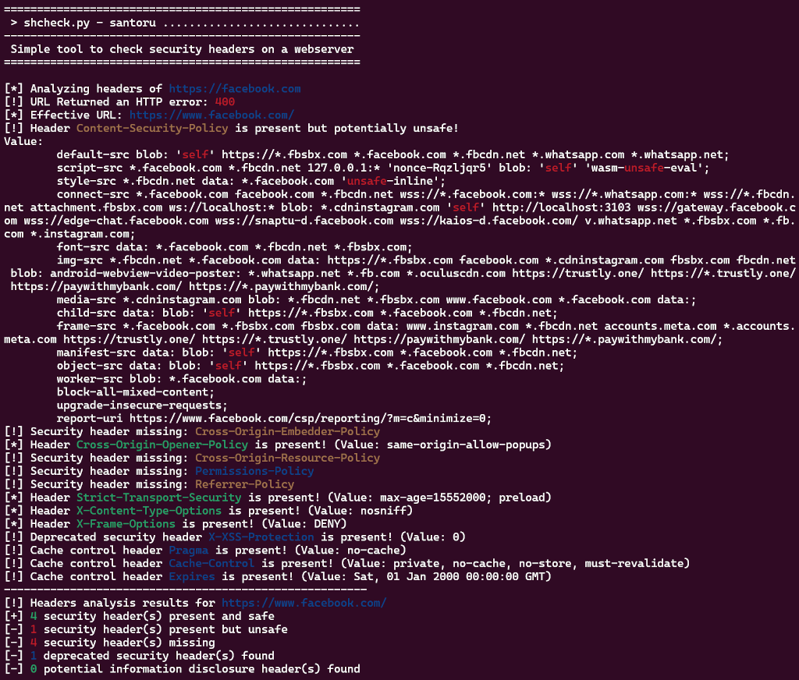

# shcheck - Security Header Check

<p align="center">
    <a href="https://pypi.org/project/shcheck/"></a>
    <a href="https://pypi.org/project/shcheck/"></a>
    <a href="#"></a>
    
</p>

## Check security headers on a target website

I did this tool to help me to check which security headers are enabled on certain websites.

The tool is very simple and it's the result of few minutes of coding.

It just check headers and print a report about which are enabled and which not.

I think there is a lot to improve, and I will be grateful if somebody wants to help.

## How to run

### Pypi

```bash
pip3 install shcheck
shcheck.py https://insecurity.blog
```

### Docker

First build your docker container using something like this:

`docker build -t shcheck .`

Then simply run your docker container using something like this where you specify which website you want to check headers on:

`docker run -it --rm shcheck https://insecurity.blog`

### From source

```bash
git clone https://github.com/santoru/shcheck && cd shcheck
./shcheck.py https://insecurity.blog
```

### Standalone script

If you want to run shcheck as a standalone script, just grab the `shcheck.py` script from the `shcheck` module/folder and copy it around.

## Usage

```
usage: ./shcheck.py [options] <targets...>

positional arguments:
  target                                        target URL(s) to check

options:
  -h, --help                                    show this help message and exit
  -p PORT, --port PORT                          set a custom port to connect to
  -c COOKIE_STRING, --cookie COOKIE_STRING      set cookies for the request
  -a HEADER_STRING, --add-header HEADER_STRING  add headers for the request e.g. 'Header: value'
  -o OUTPUT_FILE, --output OUTPUT_FILE          save the output to this file
  -q, --quiet                                   suppress terminal output
  -d, --disable-ssl-check                       disable SSL/TLS certificate validation
  -m {HEAD,GET,POST,PUT,DELETE,TRACE}, --use-method {HEAD,GET,POST,PUT,DELETE,TRACE}
                                                use a specified method
  -g, --use-get-method                          alias for -m GET
  -j, --json-output                             print the output in JSON format
  -i, --information                             display information headers
  -x, --caching                                 display caching headers
  -k, --deprecated                              display deprecated headers
  -A, --all                                     display all supported checks (-i -x -k)
  -r, --raw                                     capture raw HTTP request and response
  --proxy PROXY_URL                             set a proxy (Ex: http://127.0.0.1:8080)
  --hfile PATH_TO_FILE                          load a list of hosts from a flat file
  --colours COLOURS, --colors COLOURS           set up a colour profile [dark/light/none]
  --no-follow                                   do not follow HTTP redirects (return 3xx response)
```
